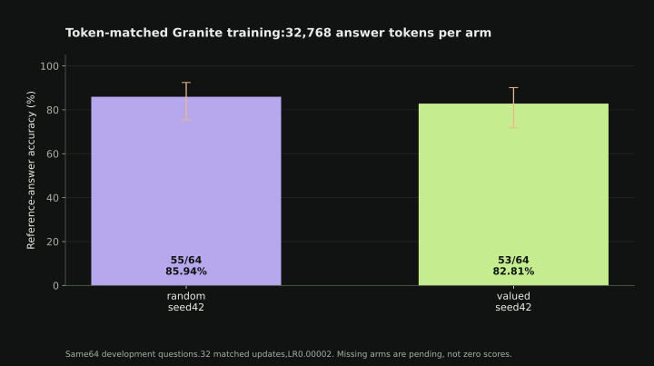

# Granite Query: Learning More from Less

Can student aware data selection teach a small Granite model mathematical reasoning more efficiently than random selection?

Granite Query compares cheap relevance/skill heuristics and a LESS-inspired gradient selector under matched training-token budgets. DeepSeek supplies concise solutions; a pinned IBM Granite 4.2 3B checkpoint learns through independent LoRA runs on Modal. Accuracy gains must be measured. A custom checkpoint, a lower training loss or a larger dataset is not evidence that ranking helped.

[Research dashboard](https://avisrikumeran.github.io/granite-query/) · [Journal](progress/JOURNAL.md) · [Accomplishments audit](progress/ACCOMPLISHMENTS.md) · [Execution plan](progress/RESEARCH_EXECUTION_PLAN.md)

## Measured results

The first completed token-matched study used the same 477 eligible teacher examples, 32,768 supervised answer tokens, 32 effective updates and 64 development questions per arm. Every adapter started independently from the pinned base.

| Seed | Random selection | Skill and diversity selection | Selected minus random |
|---|---:|---:|---:|
|42|55/64|53/64|-2 questions|
|43|57/64|56/64|-1 question|

**The skill heuristic did not beat random in either seed.** Two seeds and 64 adaptively reused development questions do not establish a general ranking advantage or equivalence. [Paired corrections, regressions and uncertainty](progress/VALUATION_RESULTS.md) are reported alongside failures.

Earlier serial development evaluation measured DeepSeek 63/64, untouched Granite 58/64, and the older BM25/random32/full120 adapters 52/64 each. These are separate historical experiments. DeepSeek used thinking / 4,096 output tokens; Granite used non-thinking / 512. Newer training evaluations use batching, the untouched batch 8 control also measured58/64, with 2 truncations and no training. Timings cannot be advertised as single-request speedups across these protocols.



The gradient study, larger human-reference expansion and final executors are in progress. **No final-test gain or public model API is claimed.** Read the dashboard for the latest measured stage; preparation, collection and student training have separate statuses.

## Data and model provenance

- Student: `ibm-granite/granite-4.2-3b`, revision `4e9c275e232f10211ec88644d106a1f6a1b60e06`; BF16, LoRA q/v projections,r8. This is adapter training, not full-parameter training.
- Teacher: DeepSeek API V4-Pro, with returned model identifiers, request settings, original responses, usage and rejects preserved privately. An API alias is not an immutable weights revision.
- Broad audit:40 Hugging Face repositories sampled across 37 declared collection families, 312 complete training rows. These are bounded samples, not 40 fully downloaded or trained datasets. [Pinned inventory](progress/HF_SOURCE_INVENTORY.json).
- Separate math expansion: 600 prompts each from SVAMP, TemplateGSM and OpenMathInstruct-2 arithmetic augmentation. 1,800 teacher attempts yielded 1,565 reference-match eligible responses and 150,750 available answer tokens. Human, procedural and majority-vote references are distinguished.
- Separate human-reference preparation: 2,048 new GSM teaching prompts and 200 disjoint training-split development questions, with prior-data/ancestry screening and exact arithmetic-annotation checks. All 2,048 teacher requests completed: 1,930 reference matches and 223,827 available answer tokens. The 200 questions never enter teaching requests. [Cohort](progress/HUMAN_MATH_COHORT.json) · [Teacher progress](progress/HUMAN_MATH_TEACHER.json).

Numeric agreement is not reasoning verification. The [reference audit](progress/SOURCE_REFERENCE_AUDIT.json) found one inconsistent SVAMP answer among 600 checked equations; that record was already rejected. All 24 gradient-selection targets passed the arithmetic/projection checks. Source ancestry detection and semantic validation remain incomplete. Official GSM8K test data stay sealed until final checkpoint and protocol freezing.

## Controlled learning loop

```mermaid
flowchart LR
    A[Training sources] --> B[Provenance, deduplication and reference checks]
    B --> C[Bounded DeepSeek requests]
    C --> D[One frozen eligible pool]
    D --> E[Random, skill and gradient selection]
    E --> F[Fresh Granite LoRA per arm]
    F --> G[Matched development evaluation]
    G -. New versioned experiment .-> B
    G --> H[Freeze checkpoint and final protocol]
    H --> I[One tracked official-test evaluation]
    I --> J[Capped API trial]
```



The new gradient method uses 24 separate human-reference selection targets, two warmup checkpoints and deterministic 1,024-dimensional CountSketch features. It is LESS-inspired, not a reproduction of LESS or a causal/Shapley value estimate. Selector warmup, feature collection, partial attempts and recovery overhead count toward cost. [Method and primary references](progress/NEXT_VALUATION_METHOD.md).

Random, skill and gradient arms use a common pool and exact answer-token budgets. The planned 32,768 / 65,536-token contrasts test selection; 131,072 tokens currently consume almost all available data and are labeled a near-all-data reference. Equal answer tokens do not imply equal input compute, examples or elapsed cost.

## Run local checks without cloud spending

Tested local environment: Python 3.12.15, Modal 1.6.3, Transformers 4.57.1, Matplotlib 3.10.7. From a new working directory on Windows:

```powershell
git clone https://github.com/AviSrikumeran/granite-query.git
Set-Location -LiteralPath '.\granite-query\granite_query'
py -3.12 -m venv .venv-modal
& '.\.venv-modal\Scripts\python.exe' -m pip install -r '.\cloud\requirements-research.txt'
& '.\.venv-modal\Scripts\python.exe' '.\cloud\check_local.py'
```

The checks use fixtures; they do not train models, send teacher requests or open the official test split. The top-level research dependencies are pinned; each cloud run also saves its installed package inventory. The older `requirements.lock.txt` belongs to the historical pilot environment.

Paid work is explicit and guarded by [the supervisor runbook](granite_query/cloud/SUPERVISOR.md): inspect durable calls/locks first, reconcile provider usage, reserve each stage, and run at most one GPU job at a time. Total ceilings are $30 Modal and $20 DeepSeek including earlier consumption. Reservations, usage observations and conservative estimates are separate; local bookkeeping is not a provider-enforced cap. Credentials never belong in repository files or chat.

## Autonomous progress and delivery

The scheduled agent advances bounded stages, preserves partial artifacts and records meaningful starts, completions, failures and fixes. `supervisor.py` itself only writes a local checkpoint; it does not launch paid work. The schedule and local teacher collectors require the computer/app to remain running; detached Modal jobs persist separately.

The public journal is append-only. Sanitized allowlisted snapshots are synchronized through GitHub, with `docs/status.json` last. The dashboard checks published snapshots every minute; publishing adds delay. Raw datasets, model responses, credentials, account details, runtime logs and weights are excluded. Public code and aggregate evidence support inspection of the method; exact stochastic-run replay requires the preserved private artifacts.

GitHub Pages currently serves the research dashboard. A scale-to-zero API is prepared with 20 permanent request permits and 24-hour expiry; it has not been deployed. Its nominal 512-output-token cap now matches evaluation; cold single-request serving and the 90-second time limit remain different conditions. Final checkpoint choice, independent evaluation and the public API/Vercel demonstration remain delivery work.

[DeepSeek technical-report audit](progress/DEEPSEEK_REFERENCES.md) · [Granite, Mistral and Llama distillation references](progress/DISTILLATION_REFERENCES.md)
