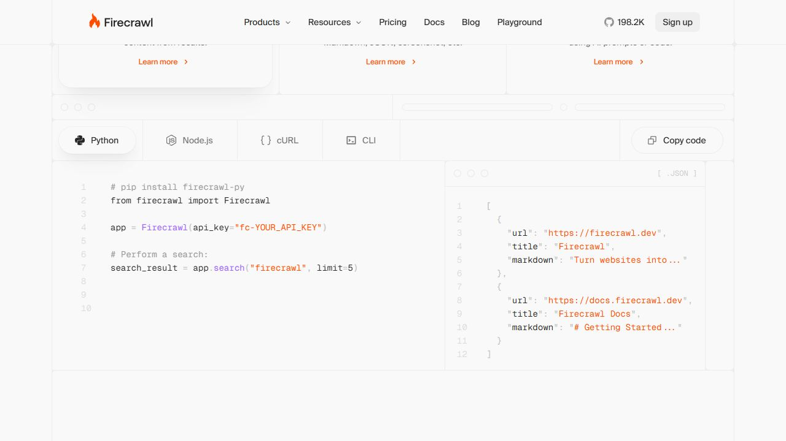
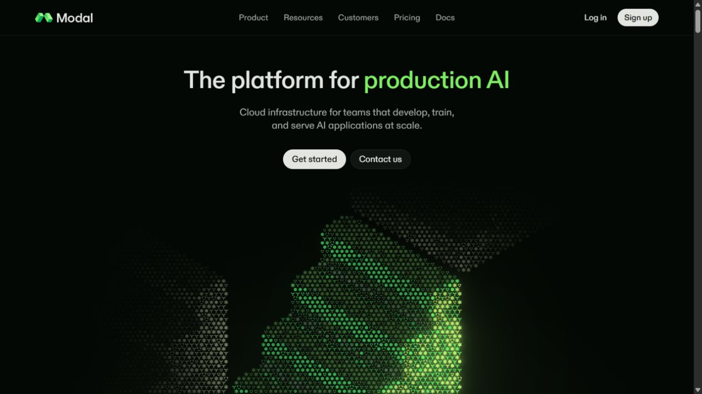
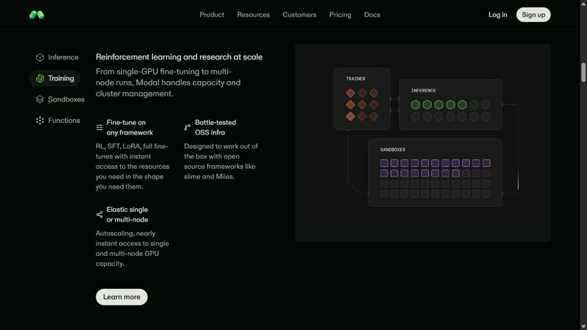
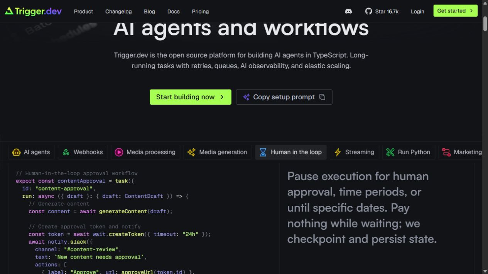
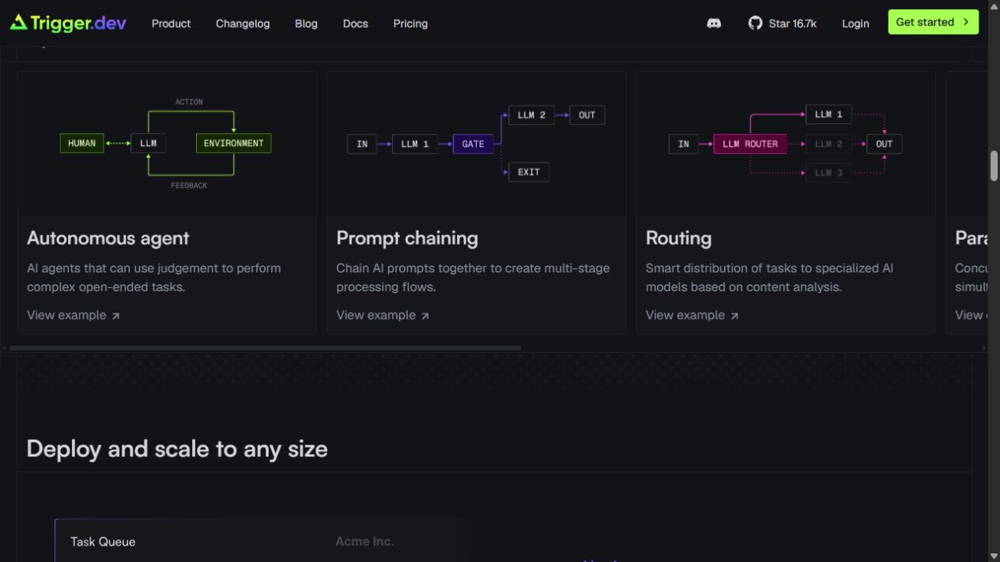
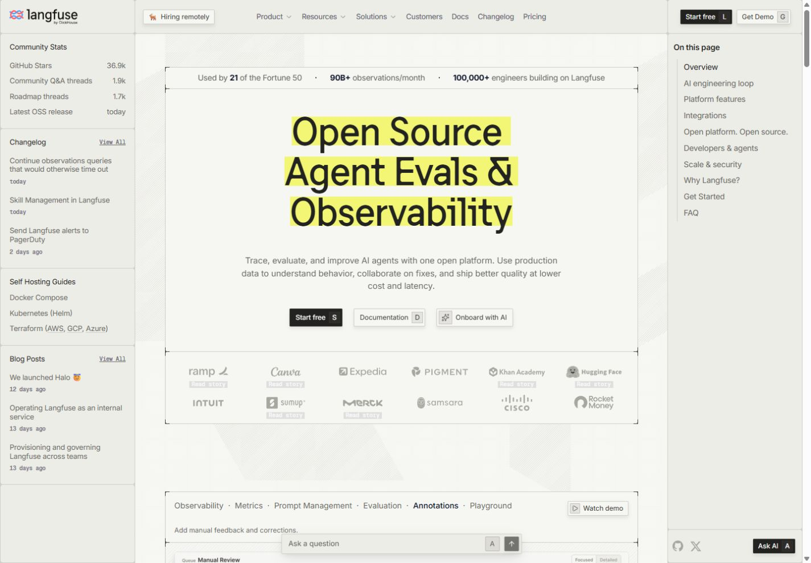
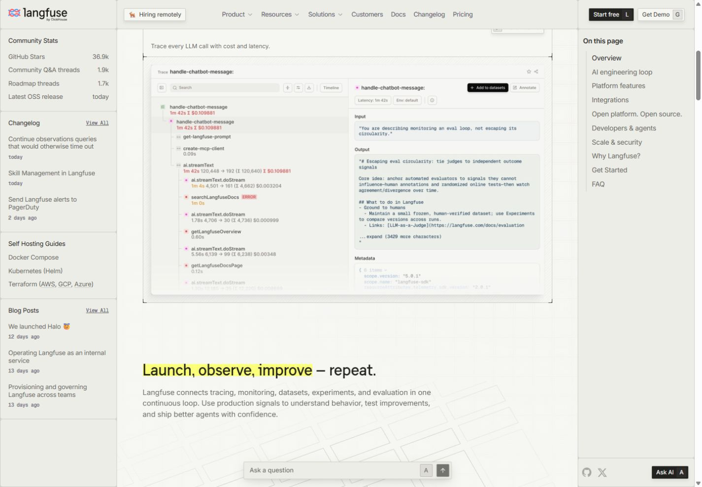

# Component reference study

Captured 3 November 2026. Desktop browser views; responsive behavior and performance of the reference sites were not audited. Decisions below are assistant recommendations awaiting user review. Build recipes describe how we could derive an original component, not a claim about a site's private implementation.

## F1 — Firecrawl: a technical grid with small geometric details

[Source website](https://www.firecrawl.dev/)

**Observed:** pale square tiles establish a consistent structure; small crosshair-like accents, dots, and text-like texture add detail without replacing the main headline.

**What I like:** the decoration has a repeatable rule. The visitor can recognize a visual language rather than a collection of unrelated effects. **Reservation:** the promotions and announcement banner create extra competing priorities.

**Derive it:** create an original SVG tile pattern or CSS grid layer behind semantic HTML. Give marks a deterministic position list rather than a randomly changing page layout. Keep decorative layers `aria-hidden` and `pointer-events: none`.

**Autonomous movement proposal:** a sparse highlight passes between a few marks on a slow cycle. **Pointer proposal:** within the illustration only, proximity subtly brightens nearby marks; pointer leave restores the baseline. That pointer effect was not verified on Firecrawl. No global cursor replacement or text movement.

**Integrate:** use the vocabulary in a bounded introductory illustration or section separators. Box/cube-like units could represent training examples, connecting the user's geometry preference to the subject. Do not imply every decorative mark is a measured datum. Start with SVG/CSS; a WebGL engine is not needed for this candidate.

**Review:** Keep / Adapt / Pass — pending. Separate verdicts: tile structure, ornament density, motion, colors.

## F2 — Firecrawl: code paired with structured output

[Source website](https://www.firecrawl.dev/)

**Observed:** language choices and a copy control sit above adjacent input/code and output panels. **What I like:** the component explains a contract: input on one side, a concrete result on the other. **Reservation:** faint text and miniature code become difficult to read; preserve the relationship, increase legibility.

**Derive it:** use a semantic two-column layout with `<pre><code>` for developer snippets and a structured result view. A single selected-example state updates both panels; keep heights stable. On narrow screens stack input before output. Copy buttons need a success/failure status.

**Interaction proposal:** provide a few real, public-safe examples. Selecting one updates the question, verification outcome, and explanation together; optional details expand on click or keyboard activation. A replay animates the explanation once, with the full final state immediately available in reduced-motion mode.

**Integrate:** explain question → DeepSeek teacher response → answer verification, with curated, approved examples in a separate static data file. Do not publish private model outputs or silently add a paid API call. Until an evaluated checkpoint/backend is ready, label examples as recorded or illustrative, not live inference.

**Review:** Keep / Adapt / Pass — pending.

## M1 — Modal: repeated geometric marks as a signature graphic

[Source website](https://modal.com/)

**Observed:** a field of repeated small symbols forms luminous clusters below a concise heading. The composition changes across browser observations. **What I like:** a large illustration grows from a small set of marks. **Reservation:** abstraction needs a nearby explanation; visual complexity alone does not demonstrate model quality.

**Derive it:** design our own small square/isometric-box glyph, arrange instances on an SVG lattice, and animate groups with transforms and opacity. For a future much denser version, benchmark Canvas before considering WebGL. Do not assume Modal's renderer from the screenshot.

**Autonomous movement proposal:** examples gather into candidate clusters, a subset is emphasized, and selected examples proceed toward a student-model unit. Use a slow illustrative sequence, not fake training progress. **Pointer proposal:** bounded parallax of the illustration or emphasis on the nearest cluster, with no displacement of labels; click/focus selects a cluster's description. Pointer reactivity was not verified on the source site.

**Integrate:** one candidate for the signature artwork. F1 and M1 should first be evaluated as alternatives; layering both across the page would dilute the identity. The IBM Granite mark is not a reusable asset for this project.

**Review:** Keep / Adapt / Pass — pending; particularly relevant to the user's box/cube preference.

## M2 — Modal: an architecture diagram that moves through stages

[Source website: Training section](https://modal.com/#workloads-training)

**Observed:** named units, connecting paths, and repeated small resource shapes sit beside the training explanation. **What I like:** it provides an inspectable explanation of otherwise invisible infrastructure. **Reservation:** small diagram text and low contrast limit readability.

**Derive it:** create a responsive SVG with a fixed viewBox and named HTML controls. Draw paths once, then animate a small marker along the active path or change the path emphasis. Keep a static ordered description available alongside the graphic.

**Autonomous movement proposal:** advance through Teacher generation → Verify → Select → Granite fine-tune → Evaluate. Show a rejected-example branch. **Pointer/focus proposal:** emphasize a stage and reveal its role; click/tap pins the detail. Pause or Replay is explicit. Hover must not trigger real jobs or change the research data.

**Integrate:** use Granite Query's actual verified-data selection and ranked/random experiment. Modal's RL diagram is a structural reference; it is not evidence that this project uses RL or the same architecture. Show random and ranked selection as comparison arms, not an unsupported winning path. Actual execution state remains a separate snapshot-driven display.

**Review:** Keep / Adapt / Pass — pending. Highest-priority explanatory candidate in this study.

## T1 — Trigger.dev: use-case tabs that change the explanation

[Source website](https://trigger.dev/)

**Observed:** selecting “Human in the loop” changes the selected tab and the associated example/code. This interaction was exercised in the browser. **What I like:** one area explains multiple specific behaviors. **Reservation:** a long horizontally overflowing tab strip makes discovery harder.

**Derive it:** a small tab controller owns a selected ID, its explanatory text, and the example. Implement tablist/tab/tabpanel semantics, arrow keys, Home/End, and visible focus. Reserve enough panel height to avoid layout jumps.

**Integrate:** compare Random selection / BM25 selection / Student-aware selection. Confirm implementation status from current research before display: student-aware work may be planned. Do not imply that each tab has completed results. Begin with manual switching; automatic sequencing belongs in the diagram, where it is clearly explanatory.

**Review:** Keep / Adapt / Pass — pending.

## T2 — Trigger.dev: small workflow diagrams with a consistent grammar

[Source website: AI app patterns](https://trigger.dev/)

**Observed:** named nodes and directional paths distinguish different workflow patterns. **What I like:** the same node/path grammar scales from one diagram to several. **Reservation:** tiny labels and horizontal overflow reduce readability.

**Derive it:** reusable SVG node, connector, branch, and label primitives with one line-weight and spacing system. Animate one active connector at a time; use hover/focus to emphasize the related description. The timing and exact rendering implementation were not verified.

**Integrate:** use the grammar for three selection strategies or a verification pass/fail explanation. Start with one large readable diagram before making a row of miniature cards. Do not show agent behaviors the project does not implement.

**Review:** Keep / Adapt / Pass — pending.

## L1 — Langfuse: an activity rail beside the main story

[Source website](https://langfuse.com/)

**Observed:** community statistics, latest release, changelog, guides, and recent posts occupy a narrow left rail. **What I like:** the project looks maintained because there is inspectable activity. **Reservation:** two rails and a floating assistant can crowd the primary reading path.

**Verified source:** [HomeSidebar.tsx](https://github.com/langfuse/langfuse-docs/blob/1f3ea78b75515191f873939d4563472eec27e1d7/components/home/layout/HomeSidebar.tsx) gathers real GitHub/release and article data. [SidebarShell.tsx](https://github.com/langfuse/langfuse-docs/blob/1f3ea78b75515191f873939d4563472eec27e1d7/components/home/layout/SidebarShell.tsx) defines sticky positioning, a 240px width, desktop visibility, and an overflow region. This is implementation evidence, not a requirement to copy their framework or dimensions.

**Derive it:** a semantic `<aside>` containing grouped lists, timestamps, and real links. Use CSS Grid and sticky positioning at desktop sizes. Move the same content into normal document flow on mobile rather than removing evidence. Build it from the existing public status snapshot and journal.

**Autonomous behavior proposal:** refresh only when a newer published snapshot arrives; discreetly mark a new entry once, without stealing focus. **Pointer/focus proposal:** highlight a row and open its corresponding journal or run detail. Snapshot refresh is not a cosmetic looping animation.

**Integrate:** show current stage, latest meaningful event, snapshot age, latest result, and methodology links. Avoid invented community statistics. Preserve completed, failed, resolved, and planned states. One evidence rail is enough to prototype.

**Review:** Keep / Adapt / Pass — pending. Highest-priority information component in this study.

## L2 — Langfuse: an inspectable trace beside input/output

[Source website](https://langfuse.com/)

**Observed:** the observability preview puts nested work on the left and its details on the right. This homepage component is a product preview, not a fully exercised trace application. **What I like:** readers can relate an outcome to the steps that produced it. **Reservation:** a screenshot of a dense interface is not enough; our actual component must keep key text readable.

**Derive it:** a run list and a selected-run detail panel, populated from approved public summaries. Use stable IDs. Selecting a run preserves the filter and scroll position; on mobile the detail follows the selected item. Only expose latency, token counts, seeds, costs, and per-question results when those fields actually exist and are approved for publication.

**Verified related source:** Langfuse's [FeatureTabs.tsx](https://github.com/langfuse/langfuse-docs/blob/1f3ea78b75515191f873939d4563472eec27e1d7/components/home/feature-tabs/FeatureTabs.tsx) uses state-controlled selection, viewport detection, reduced-motion-aware transitions, keyboard navigation, and Escape to toggle auto-advance. We should implement explicit visible pause controls as well.

**Integrate:** an experiment explorer linking selection method, training budget, evaluation split, and limitations. A demonstration specimen may use clearly labeled fixtures; published evidence must use actual approved data. Never synthesize a convincing trace from absent telemetry.

**Review:** Keep / Adapt / Pass — pending.

## GitHub findings and limits

| Source | Verified finding | Use in this project |
| --- | --- | --- |
| [langfuse/langfuse-docs](https://github.com/langfuse/langfuse-docs) | Actual homepage component source located and read; [MIT license](https://github.com/langfuse/langfuse-docs/blob/1f3ea78b75515191f873939d4563472eec27e1d7/LICENSE) inspected | Study the component/data boundaries and interaction states; no source code copied in this study |
| [motiondivision/motion](https://github.com/motiondivision/motion) | Official [Motion README](https://github.com/motiondivision/motion/blob/main/packages/motion/README.md) describes JavaScript/React/Vue animation support; [MIT core license](https://github.com/motiondivision/motion/blob/main/LICENSE.md) inspected | Optional animation helper if a measured prototype needs it; use browser CSS/SVG/WAAPI first for the current static page |
| [triggerdotdev/trigger.dev](https://github.com/triggerdotdev/trigger.dev) | Product monorepo found; inspected tree did not establish the captured marketing components' implementation | Website is visual/interaction evidence only; don't claim it provides a drop-in homepage component |
| [firecrawl/firecrawl](https://github.com/firecrawl/firecrawl) | Product repository and public examples found; marketing-grid source not established | Derive an original grid and input/output component rather than claim verified source reuse |
| [modal-labs](https://github.com/modal-labs) | Public SDK/examples repositories found; no exact homepage renderer established in this search | SVG/Canvas plan is our approach, not a report of Modal's technology |

No conversion analytics, motion-performance audit, full accessibility audit, or representative social-opinion sample was available. The study supports specific design hypotheses, not a claim that these details caused company growth.
