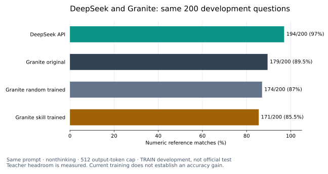

# DeepSeek and Granite on the same200 development questions

All four models answered the same200 GSM8K TRAIN development questions, with the same user prompt, nonthinking mode and512-token output cap. These questions remain excluded from teaching. This is an output-budget diagnostic, not the strongest-practical teacher benchmark or an equal-compute/latency experiment.

| Model | Numeric reference matches | Accuracy | Truncated |
|---|---:|---:|---:|
| DeepSeek API |194/200|97.0%|0|
| Untouched Granite |179/200|89.5%|8|
| Random-trained Granite |174/200|87.0%|2|
| Skill-trained Granite |171/200|85.5%|2|

DeepSeek minus untouched Granite is +7.5 percentage points, with exploratory paired question-bootstrap95% interval[4.0,11.5]. DeepSeek solves16 questions the base misses; the base solves1 that DeepSeek misses. Seven of those16 base misses were capped; nine were uncapped. The gap therefore is not solely truncation.

DeepSeek minus random is +10.0points[5.5,14.5], and minus skill is +11.5points[7.0,16.5]. These intervals cover question resampling, not training-seed variation or multiple comparisons. Both training runs used seed42; no ranking advantage or Granite accuracy improvement is established.

All200 original teacher intents and raw wire receipts were replayed and verified. There were no API failures, unknown-usage attempts or retries. DeepSeek has189 strict-format matches plus5 using the existing final-line numeric fallback. Final-answer matches do not validate every reasoning step; references may have interpretation-sensitive cases. The returned mutable API alias was deepseek-v4-pro. Peak-rate recorded token estimate is$0.10926432, settled conservatively as$0.11; this is not an invoice. No new GPU training ran for this measurement.

The current teaching pool has1930 eligible concise examples. The recent random/skill arms used561/766 examples respectively, each with65536 supervised tokens and64updates. More examples alone cannot be assumed to fix the observed regressions. Next design work prioritizes a bounded reasoning-transfer and learning-curve experiment with random controls, before bulk final-benchmark spending. The official test set remains sealed, and the public model API remains undeployed.

This200-question result is separate from the older64-question thinking4096 comparison and from any eventual official final evaluation. Different tokenizers, decoding implementations and hardware prevent interpreting nominal equal caps as equal FLOPs or matched latency.
