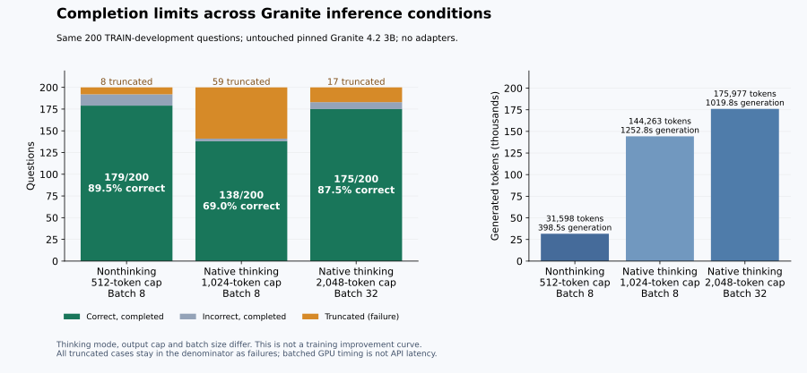

# Native reasoning configuration recovery

The full 200-question OPEN/1024 baseline and raw replay validate. Its measured runtime exceeds the training-pair forecast gate; neither adapter was launched. Preserve this completed baseline and review a separately versioned protocol within the original budget.

Both prior attempts remain failed with 0 validated evaluation outputs and no accuracy.

Planned funding: $3.50 transferred unused allowance plus a NEW $1.75 reservation within the original $30 ceiling. This is not additional cash.

| New condition | Status | Accuracy |
|---|---|---|
| Fresh untouched Granite | completed | 69.0% |
| Concise supervision | prepared | Unavailable |
| Native reasoning supervision | prepared | Unavailable |

- Two earlier failed attempts remain separately preserved; this is a new reviewed version, not an automatic retry.
- Prepared code and funding reservations do not establish GPU completion or model improvement.
- The additional $1.75 is a reservation within the existing $30 ceiling, not additional cash.
- All student metrics require exact new controller/input/manifest/dispatch/provider-terminal/full-raw-replay receipts.
- Adaptive 200-question TRAIN-development evaluation, one training seed and OPEN/1024 inference; prior nonthinking 512-token results are separate.
- Complete 16k-token supervision matches loss-token exposure, not example counts or compute; this is a recipe comparison, not ranker superiority.
- No guaranteed improvement or verification of every intermediate reasoning step is implied.
